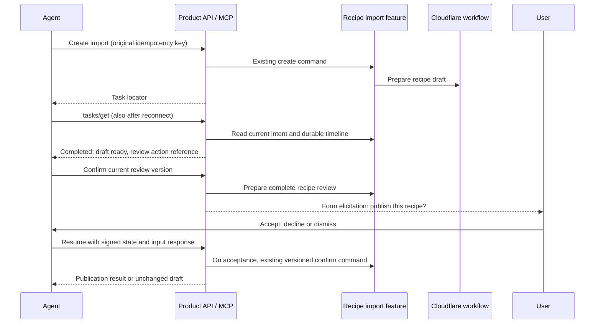

# Meal Planner API and MCP

The public API and MCP use the application's existing domain handlers. They share validation, household permissions, mutation receipts, version checks, durable imports and review gates. The browser continues to use those handlers too.

## Connect

For a deployment with public origin `https://ceird.app`:

| Surface | Address |
| --- | --- |
| MCP | `https://ceird.app/mcp` |
| OpenAPI | `https://ceird.app/v1/openapi.json` |
| API authorization resource | `https://ceird.app/v1` |
| MCP authorization resource | `https://ceird.app/mcp` |
| Authorization server metadata | `https://ceird.app/.well-known/oauth-authorization-server/api/auth` |
| API protected-resource metadata | `https://ceird.app/.well-known/oauth-protected-resource/v1` |
| MCP protected-resource metadata | `https://ceird.app/.well-known/oauth-protected-resource/mcp` |

Configure an MCP client with the MCP address and follow its OAuth connection flow. Better Auth owns dynamic registration, authorization codes, PKCE S256, consent, refresh and revocation. The account owner signs in or creates an account through the browser and explicitly allows the requested access. Passwords, browser cookies and retailer credentials are not MCP arguments.

Tokens are bound to their resource. An API token cannot be used at MCP, or vice versa. A current account session, current consent and current household membership are checked at use time. A client name shown at consent is supplied by that client and is not an endorsement.

The official MCP server SDK handles both legacy negotiation and the stateless `2026-07-28` protocol. The latter requires its native request metadata and headers; it is not a legacy initialize exchange with a different version string. Local tests exercise both protocols. Connecting the deployed endpoint from ChatGPT, Claude, Cursor and Durable Pi remains a release acceptance check.

Client ID Metadata Documents are disabled: the installed native provider requires a DNS-pinned transport for safe metadata fetching, which the Workers integration does not supply. Dynamic client registration is supported.

## Permissions

| Scope | Access |
| --- | --- |
| `meal-planner:read` | Shared family data and invitations addressed to the user |
| `meal-planner:write` | Domain mutations, including durable recipe imports |
| `meal-planner:account` | Safe account identity projection |
| `meal-planner:private` | The user's own private interview and setup data |
| `meal-planner:assistant` | Application assistant conversations |
| `offline_access` | Native refresh tokens, subject to current grant and session checks |

Mutating an assistant or private interview also requires `meal-planner:write`. Private assistant turns require both private and assistant permissions. Scope checks admit an operation; the existing domain still decides whether this user can act on this family, person, version or private session.

MCP discovery includes only tools permitted by the connection. The public OpenAPI document describes all supported operations and their required scopes. Operator recovery, provider accounting administration, service RPC and private Tesco session enrollment are excluded.

## Use the API

Acquire a token using authorization code with PKCE and the `/v1` resource. Then list families:

```sh
curl --fail-with-body "$MEAL_PLANNER_ORIGIN/v1/families" \
  -H "Authorization: Bearer $MEAL_PLANNER_ACCESS_TOKEN"
```

Routes whose path does not name a family require `x-meal-planner-household` with an ID returned by that list. This selects a family for the request without changing the browser session. MCP represents this as the required `familyId` argument. Never guess a family or person ID.

Read the operation's OpenAPI schema before constructing a mutation. Existing version and identity fields are required intentionally:

1. Read the current record and version.
2. Create one mutation ID or idempotency key for the intended action.
3. Submit the change with the expected version.
4. After an uncertain response, reuse that identity or read its status. A new identity can create a second operation.
5. After a version conflict, read the new state before proposing a revised change.

Delegated requests share an account limit of 120 admissions per minute across all clients. MCP envelopes and individual tool executions both count, so batching cannot bypass it. A rate-limit response supplies `Retry-After`. Domain and provider budgets remain independently enforced. This is an operational limit, not a billing meter. The existing deployment-wide recipe budget also remains shared; customer entitlements and commercial quota fairness require a separate launch decision.

## Recipe imports

Use `recipe_import_intents_create` for one TikTok video URL, or `recipe_import_batches_create` for a batch. Poll the returned ID. Imports continue through the existing Cloudflare workflow rather than holding an MCP request open.

When an import requires review, read its action, submit corrections, then explicitly confirm that version to publish it. An extracted draft is never a published recipe. Cancellation and status reads retain their existing durable semantics.

The existing import feature accepts TikTok URLs. Binary video upload and publishing videos to TikTok are not existing capabilities and are not implied by this interface.

### Tasks and elicitation

Modern clients can negotiate the [Tasks extension](https://tasks.extensions.modelcontextprotocol.io/specification/2026-07-28/tasks) and [form elicitation](https://modelcontextprotocol.io/specification/2026-07-28/client/elicitation). Support is scoped to recipe import preparation and publication review:

| Operation | Negotiated behavior | Ordinary fallback |
| --- | --- | --- |
| `recipe_import_intents_create` | Returns a Task when the client advertises Tasks and the connection has read and write scopes | Returns the durable import intent |
| `tasks/get` | Projects progress and the first terminal outcome from the existing import timeline | Read the import intent and timeline |
| `tasks/cancel` | Requests existing domain cancellation while preparation is working; acknowledges a terminal Task without changing it | Cancel the import using its current version |
| `tasks/update` | Validates the request and current access, then acknowledges unknown or already-satisfied input responses; preparation Tasks do not await input | Not needed |
| `recipe_import_intents_confirm_action` | With read and write scopes, requests an explicit publish decision with the complete recipe and planning tags through form elicitation | Existing explicit, versioned confirm command |



A Task means **prepare a recipe draft**. It completes when the first review action becomes available, even though publication is still pending. Later edits, publication, cancellation of that draft or operator recovery do not rewrite the Task's terminal outcome. Read the import's current status before using a historical action reference. An extraction failure is a completed tool result with `isError`; a redirected import returns its canonical reference without automatically following it. Batch imports retain their existing admission semantics and do not pretend that admitting a batch means its recipes are ready.

Task locators expire seven days after import admission. They are signed and bound to the account, OAuth client, family and import; they survive token refresh and reconnect by the same authorized client. Every access still checks current OAuth authority and family membership. Signing does not grant access. Retain the original import ID and mutation identity if a locator expires. Poll using `pollIntervalMs`; subscriptions and legacy experimental Tasks methods are not implemented. A cancellation acknowledgement is not a promise that an external provider has physically stopped.

Publication uses the modern multiple-round-trip input flow. The response contains an `elicitation/create` form in `inputRequests.publish` and an opaque `requestState`. Resume the same tool call and original arguments with that state and `inputResponses.publish`. The state binds the exact action version and idempotency key, expires after ten minutes, and is checked against the current account and OAuth client. Only `accept` with `content.publish: true` submits the existing confirm command. Decline, dismiss and false leave the draft unchanged. Successful retries use the domain's original mutation receipt; stale versions require a fresh review. Elicitation is a client-mediated decision, not independent evidence of a human click.

The preview contains the full structured recipe and planning tags. Incomplete, stale or oversized previews require the existing app review flow rather than implicit confirmation. This slice implements form mode only; URL elicitation and elicitation inside background Tasks are not implemented. Clients without form support or read permission keep the existing explicit confirmation flow. Tesco's separate MCP is unchanged.

### Feature ownership and verification

The recipe import feature owns preparation outcomes and publishable review previews in `imports/import-mcp.ts`. The product API feature owns protocol negotiation, signed interaction state and translation to its existing typed application commands. Existing domain handlers, durable timeline, mutation receipts and Cloudflare workflow remain the authority for state changes. No Task database or second workflow engine is introduced.

The native MCP SDK owns protocol decoding and response framing. Effect owns request cancellation and application execution. One bounded WebCrypto signer serves the two interaction payloads: Task IDs need deterministic issuance with an absolute domain expiry, while the SDK request-state helper uses a fresh wall-clock-relative expiry on every issue. Purpose-separated schemas prevent a review continuation being used as a Task locator.

Run the focused checks from the repository root:

```sh
pnpm --filter @meal-planner/api exec vitest run --project node \
  src/features/imports/import-mcp.test.ts \
  src/features/product-api/product-mcp-state.test.ts \
  src/features/product-api/product-mcp-interactions.test.ts \
  src/features/product-api/product-api.test.ts
pnpm --filter @meal-planner/worker-tests exec vitest run \
  ../../apps/api/src/features/product-api/product-api.integration.worker.test.ts
```

The interaction tests exercise the actual MCP HTTP transport against an in-memory application fixture, including stable terminal results, reconnect ownership, stale and forged continuations, acceptance replay and declined publication. They do not run extraction providers or establish production client interoperability. The native Worker integration suite checks the OAuth and MCP boundary with the real auth database and family handlers. Before rollout, test the selected agent client's capability negotiation, reconnect, review display, acceptance, decline and dismissal against an authenticated deployment using test data.

## Assistant and private interviews

Assistant turn operations accept a stable turn ID and return the persisted conversation state. Read the existing conversation endpoint to follow progress. Private interview APIs expose the same participant commands, message/card pagination, turn cancellation and confirmation continuation as the browser. They use server-owned request registration and current privacy authority, without exposing socket generation metadata to callers.

Private interview transcripts remain private to their participant. Accepting a profile card follows the existing explicit sharing and safety checks. Shared family food profiles and private interview history are distinct resources.

## Account and Tesco boundaries

The native account HTTP API remains under `/api/auth/`, including email signup/signin, session, signout and password recovery. MCP connection establishment uses those browser flows. The `account_read` tool returns only ID, name, email and email verification status.

Tesco retains its separate private credential and owner session. Its existing operations are available through both MCP and HTTP, using the same typed operation registry and mutation receipts. The private service exposes `GET /openapi.json` and `POST /v1/<tool-name>`; see [the Tesco interface](../apps/api/src/features/tesco/mcp/README.md) for authentication, retry and checkout review requirements. Connecting the general Meal Planner MCP does not grant access to that retailer session. Customer retailer enrollment and tenancy remain separate launch work.

## Deployment and acceptance

Apply the generated OAuth auth-database migration through the existing Alchemy deployment path. Deploy the website and API together: public profile commands now derive acceptance authority and no longer accept the old caller-supplied basis. Dedicated storage readers preserve already-persisted history and pending operations.

`MEAL_PLANNER_PUBLIC_ORIGIN` fixes the issuer and audience origin. Production and local test stages have explicit defaults. Unconfigured preview stages keep delegated OAuth disabled instead of trusting an arbitrary request host. Configure a stable HTTPS preview origin before testing external clients there.

Rollout checks are:

- Run repository quality, native Worker, browser and stack gates on the final revision.
- Complete signup/signin, consent Allow and Deny, refresh, disconnect and reconnect through the public origin.
- Connect each intended agent client; list families, read a family and perform one reversible mutation using its original retry identity.
- Check denied scopes, a second user's family, and private interview ownership.
- Complete a recipe import through review and explicit publication with test data.

The local integration tests cover native OAuth and both MCP protocols. Live client interoperability, production rollout and commercial billing are separate acceptance work; they are not established by a passing unit test.

The state-machine choice and the reproduced `@xstate/effect` cleanup issue are recorded in [the compatibility note](research/xstate-effect-compatibility.md). The implementation uses stable XState with the installed Effect v4 cancellation boundary until that upstream lifecycle issue is resolved.
